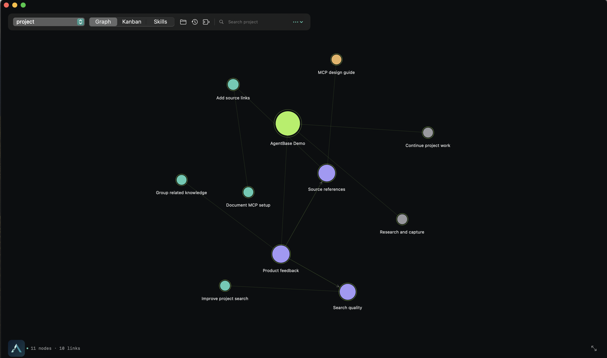
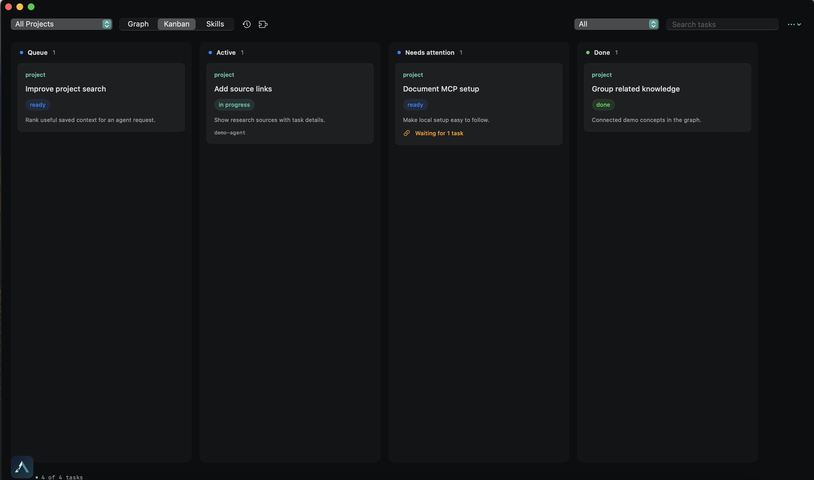

# AgentBase

**Project memory for AI agents.** Keep decisions, research, tasks, and analysis connected so work can pick up again in a fresh session.

AgentBase is a local-first MCP server and Codex plugin. It stores project knowledge on your machine and gives agents a searchable record of what happened, why, and what to do next.

## See it

| Project knowledge | Work at a glance |
| --- | --- |
|  |  |

## What it does

- Saves sourced knowledge, decisions, plans, and handoffs.
- Tracks tasks, dependencies, progress, and completion evidence.
- Helps agents find relevant past work and continue it across sessions.
- Imports and analyzes project data locally.
- Includes a native macOS inspector for the knowledge graph and task board.

AgentBase does not call a model or send project data to a hosted service. The MCP server and project store run locally.

## Quick start

Requires Node.js 22.22 or newer and Codex.

```sh
git clone https://github.com/SeanPreusse/agentbase.git
cd agentbase
npm ci
npm run plugin:up
```

Start a fresh Codex session to load the plugin. On macOS 14 or newer, `npm run ui` builds and opens the inspector.

## Contribute

AgentBase is open source under the Apache-2.0 license, and contributions are welcome. Open an issue to report a bug or discuss an idea; pull requests for code, docs, tests, and design are welcome too.

To get started, install Node.js 22.22+, run `npm ci`, make a focused change, and run `npm test`. For inspector changes on macOS, run `npm run test:ui` as well. Please describe the problem your change solves and what you checked.

## License

Apache-2.0. See [LICENSE](LICENSE).
