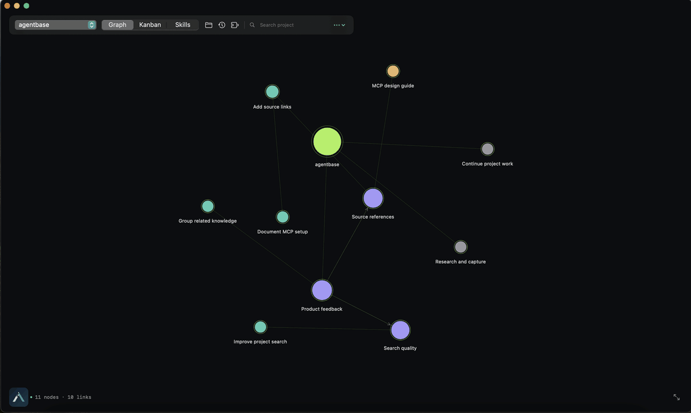

# AgentBase

**Local-first storage and memory for AI agents.** Keep project knowledge, tasks, data, and analysis together so work can pick up again in a fresh session.

AgentBase is an MCP server, Codex plugin, and macOS inspector for persistent project state. Its local SQLite store keeps knowledge and work history; DuckDB powers sandboxed SQL analysis over imported project data. Claude Code can connect through MCP.

## App preview



[Graph screenshot](docs/screenshots/graph.png) · [All-tasks screenshot](docs/screenshots/kanban.png)

## What it does

- Stores sourced knowledge, decisions, tasks, plans, and handoffs in a local project database.
- Uses DuckDB to run sandboxed SQL over imported CSV, JSON, JSONL, and Parquet data; saved analyses keep their query, bounded results, and provenance.
- Backs up project records and imported dataset files together.
- Helps agents find relevant past work and continue it across sessions, with a native macOS inspector for the graph and task board.

AgentBase does not call a model or send project data to a hosted service. The MCP server and project store run locally.

## Quick start

Requires Node.js 22.22 or newer and Codex or Claude Code.

```sh
git clone https://github.com/SeanPreusse/agentbase.git
cd agentbase
npm ci
npm run plugin:up
```

Start a fresh Codex session to load the plugin. In the macOS inspector, open Connections to install AgentBase for Claude Code. `npm run ui` builds and opens the inspector on macOS 14 or newer.

## Contribute

AgentBase is open source under the Apache-2.0 license, and contributions are welcome. Open an issue to report a bug or discuss an idea; pull requests for code, docs, tests, and design are welcome too.

To get started, install Node.js 22.22+, run `npm ci`, make a focused change, and run `npm test`. For inspector changes on macOS, run `npm run test:ui` as well. Please describe the problem your change solves and what you checked.

## License

Apache-2.0. See [LICENSE](LICENSE).
